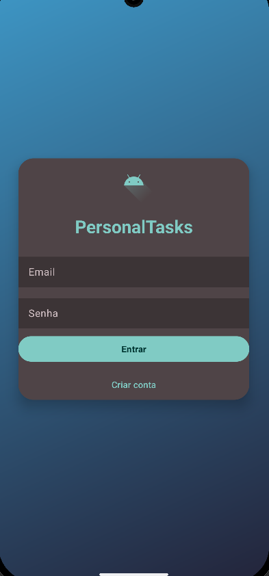
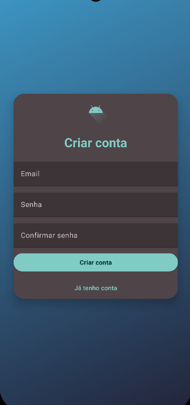
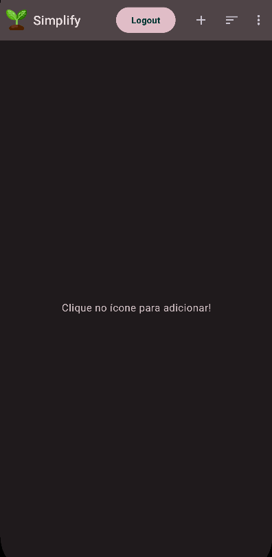
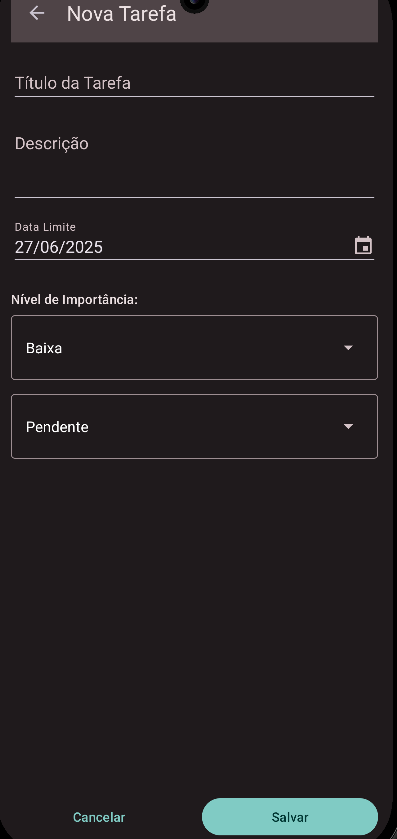
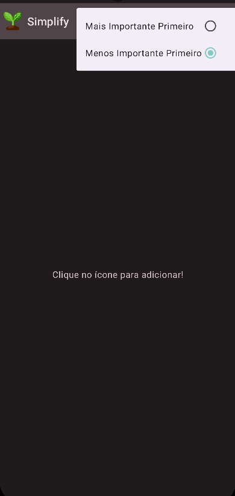
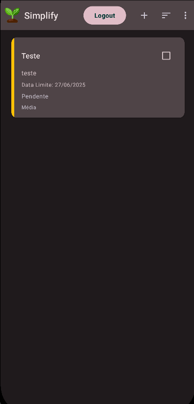
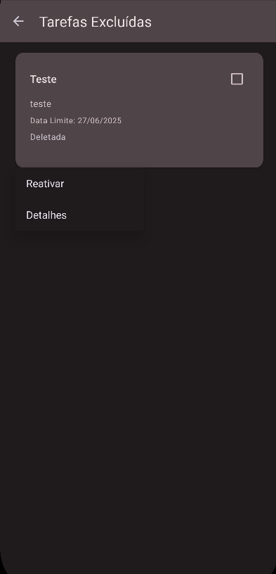

# PersonalTasks

An Android app to manage personal tasks, with authentication and remote persistence through Firebase.

**Author:** Alan Souza  
**Email:** alansouzeesi@gmail.com

## Description

PersonalTasks lets you create, view, edit, complete and delete daily tasks, with real-time sync through Firebase Realtime Database and built-in offline support. Besides the main task list, it has a deleted-tasks history where you can reactivate tasks or review their details in read-only mode.

## Features

**Firebase authentication:** sign in and sign out with Firebase Authentication.

**Main task list:**
- Shows tasks with **Active** or **Completed** status.
- Checkbox to mark or unmark completion without deleting.
- Importance indicator (High, Medium, Low).
- Sorting by importance and due date, with the preference saved.

**Task CRUD:**
- **Create** a task (title, description, date, importance).
- **Edit** an existing task.
- **View details** in read-only mode.
- **Delete** (soft delete, status `DELETED`).

**Deleted tasks history:**
- A dedicated screen lists only tasks with status `DELETED`.
- **Long press** an item to open a context menu: **Reactivate** (status goes back to `ACTIVE`) or **Details** (opens `TaskDetailActivity` in read-only mode).

**Sync and offline support:**
- Local persistence and automatic cache through `FirebaseDatabase.setPersistenceEnabled(true)`.
- Reads and writes work without a connection and sync when you are back online.

**Feedback and validation:**
- Toasts and confirmation dialogs for saving, deleting or discarding changes.
- Field validation: title (max 50 characters), description (max 250), date (past dates not allowed).

## Demo video

[Watch the demo](https://youtu.be/xFnd6h0Tuuo)

## Screenshots

**Login**  


**Register**  


**Main screen**  


**Add a new task**  


**Sort tasks**  


**Deleted tasks (empty)**  


**Task added**  


**Deleted tasks (with tasks)**  


## Getting started

1. Clone the repository:

```bash
git clone https://github.com/Alan-VSouza/PersonalTasks.git
```

2. Open the project in Android Studio (4.2+ recommended).
3. Make sure `minSdk` is 26 or higher.
4. Add your own `google-services.json` file to the `app/` folder (Firebase Console, project settings).
5. Sync Gradle and run on an emulator or device (API 26+).

## Usage

1. **Login:** register or sign in with email and password through Firebase.

2. **Main screen:**
- Active and completed tasks appear in a `RecyclerView`.
- Use the "+" icon to add a task.
- Long press a task for a menu with "Details", "Edit" or "Delete".
- Use the checkbox to mark or unmark completion directly.

3. **Details, editing and deletion:**
- **Details:** read-only mode.
- **Edit:** fields enabled for changes.
- **Delete:** asks for confirmation before removing (soft delete).

4. **Deleted tasks history:**
- Open it from the top menu, under "Deleted tasks".
- Long press an item for a menu with "Reactivate" or "Details".

5. **Sorting:**
- Use the sort icon in the top menu: "Most important first" or "Least important first".
- The preference is saved in `SharedPreferences`.

## Architecture

The app uses **MVVM** with separated layers:

- **Model:** `Task` class (with an empty constructor for Firebase).
- **ViewModel:** `TaskViewModel` exposes `LiveData<List<Task>>` for active and deleted tasks.
- **Repository:** `FirebaseTaskRepository` abstracts the CRUD operations on Firebase.
- **View:** Activities (`MainActivity`, `TaskDetailActivity`, `DeletedTasksActivity`) using ViewBinding.

## Security rules (Realtime Database)

In the Firebase Console, under Realtime Database > Rules:

```json
{
  "rules": {
    "tasks": {
      "$uid": {
        ".read": "auth != null && auth.uid == $uid",
        ".write": "auth != null && auth.uid == $uid",
        ".indexOn": ["status"]
      }
    }
  }
}
```

## Contact

Questions or suggestions: **alansouzeesi@gmail.com**.
